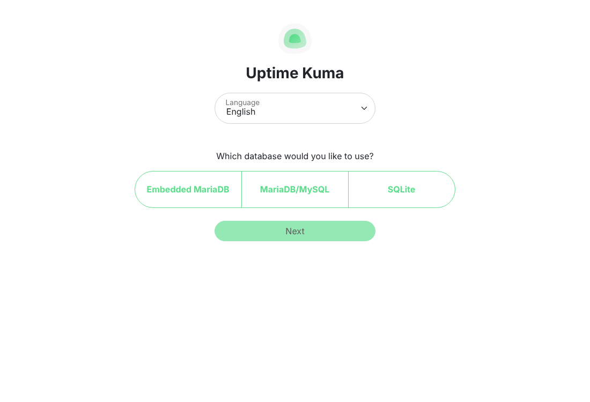
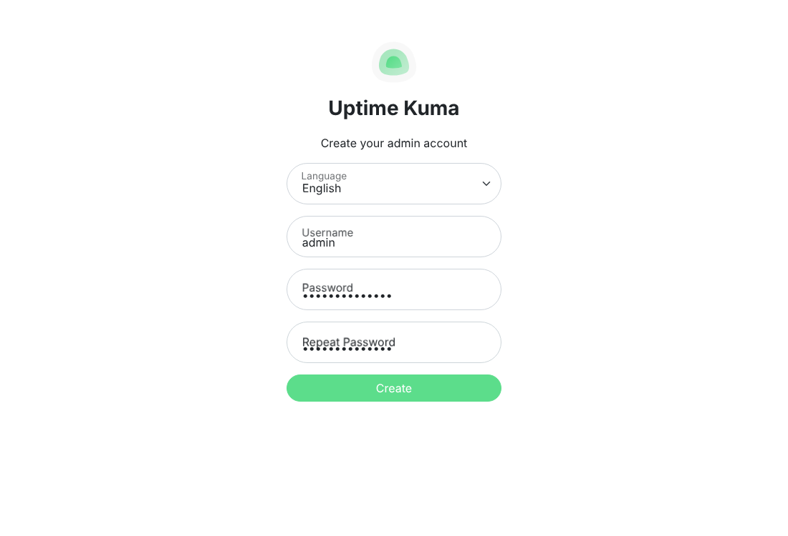
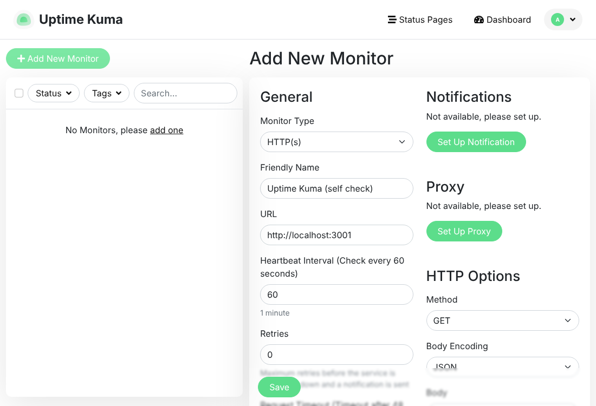
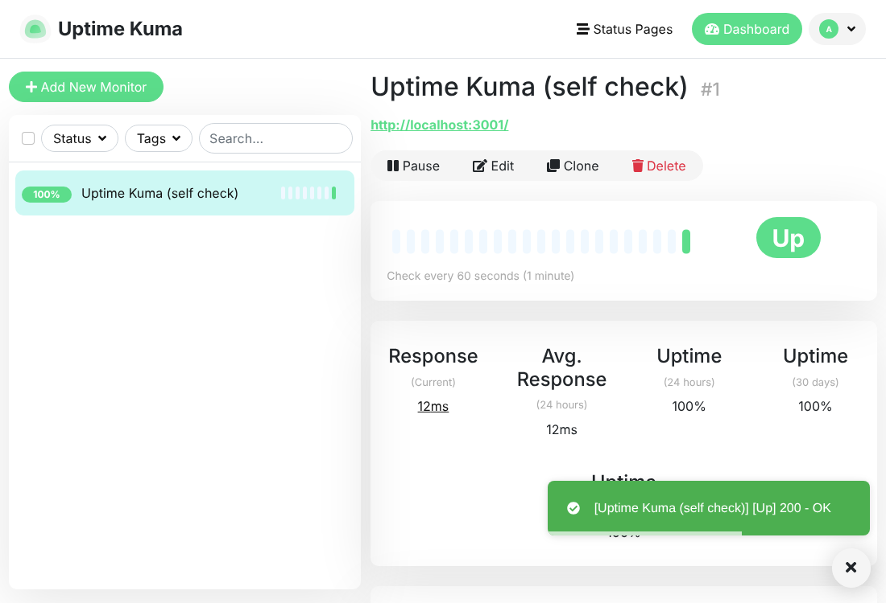

# Uptime Kuma Setup

A ready-to-run setup for [Uptime Kuma](https://github.com/louislam/uptime-kuma), a free, self-hosted
monitoring tool. It checks your websites, servers, and services, alerts you (email, Slack, Telegram,
Discord, and 90+ others) when something goes down, and can host a public status page.

Included:
- `docker-compose.yml`: Uptime Kuma v2, plus optional automatic HTTPS through Caddy
- `install.sh`: installs Docker if needed and starts everything
- `backup.sh`: backs up all monitors, settings, and history
- Step-by-step guide with screenshots (below)

---

## Step-by-step

### Step 1: Get a server
Any Linux machine with **1 GB RAM** works: a cloud VM (AWS EC2 t3.micro, DigitalOcean, Hetzner),
a Raspberry Pi, or your own computer for testing.

> Run the monitor on a **different** machine from the things you monitor. If they share a server
> and it goes down, nothing is left to alert you.

Open these ports in your firewall or AWS security group:
- **3001** for plain HTTP (simple setup), or
- **80 and 443** for HTTPS with a domain (recommended)

### Step 2: Download this project
```bash
git clone https://github.com/<your-user>/uptime-kuma-setup.git
cd uptime-kuma-setup
```

### Step 3: Start Uptime Kuma

**Option A, quick start (HTTP):**
```bash
./install.sh
```
Then open `http://<server-ip>:3001`.

**Option B, HTTPS with your own domain (recommended for real use):**
1. In your DNS, create an **A record**, for example `status.yourdomain.com`, pointing to the server's IP.
2. Set the domain:
   ```bash
   cp .env.example .env
   nano .env            # DOMAIN=status.yourdomain.com
   ```
3. Start it:
   ```bash
   ./install.sh --https
   ```
   Caddy gets a free Let's Encrypt certificate automatically. Open `https://status.yourdomain.com`.

Already have Docker? You can skip the script and run `docker compose up -d`.

### Step 4: Choose the database
On first visit, pick **SQLite** (simplest, fine for hundreds of monitors) and click **Next**.
The first start takes up to a minute.



### Step 5: Create your admin account
Choose a username and a **strong password**. Anyone who reaches this page first becomes the admin,
so do this right away.



### Step 6: Add your first monitor
Click **Add New Monitor**:
- **Monitor Type:** `HTTP(s)` for websites (others include Ping, TCP Port, DNS, Docker container, and Push)
- **Friendly Name:** for example `My website`
- **URL:** for example `https://yourwebsite.com`
- **Heartbeat Interval:** how often to check (60 seconds is a good default)

Click **Save**.



Green **Up** means it's working; the bar shows each recent check.



### Step 7: Set up alerts
**Settings → Notifications → Setup Notification**, then pick a service:

| Service | What you need |
|---------|---------------|
| **Email (SMTP)** | SMTP host, port, user, password. For Gmail, use an [App Password](https://myaccount.google.com/apppasswords) with `smtp.gmail.com`, port 587 |
| **Telegram** | Bot token from [@BotFather](https://t.me/BotFather) and your chat ID |
| **Slack / Discord** | An incoming webhook URL |

Tick **Default enabled** and **Apply on all existing monitors**, click **Test**, then **Save**.

### Step 8 (optional): Create a public status page
**Status Pages → New Status Page**, give it a name and a slug (for example `status`), add your monitors,
and click **Save**. Share `http://<server>/status/status` with your users.

### Step 9: Turn on two-factor authentication
**Settings → Security → 2FA**. Strongly recommended if Uptime Kuma is reachable from the internet.

---

## Example monitors

| What | Monitor type | Example |
|------|--------------|---------|
| Website | HTTP(s) | `https://example.com` |
| Website contains text | HTTP(s) - Keyword | URL + keyword `Welcome` |
| Server is reachable | Ping | `203.0.113.10` |
| Database port open | TCP Port | host `db.internal`, port `5432` |
| SSL certificate expiry | HTTP(s) | enable "Certificate Expiry Notification" |
| Cron job / script ran | Push | see below |

### Push monitors: get alerted when a script stops running
A **Push** monitor works the other way round: your script calls Uptime Kuma, and you get an alert if it
**stops** calling. Create a monitor with type **Push**, copy its URL, and call it from cron.

Example with [disk-alert](https://github.com/n6jannat/disk-alert): report "down" when a disk is
nearly full, and also get alerted if the server dies completely:
```cron
*/5 * * * * /usr/local/bin/disk-alert -q -w 80 -c 90 >/dev/null; s=$?; [ $s -eq 0 ] && st=up || st=down; curl -fsS -m 10 "https://status.yourdomain.com/api/push/YOUR_TOKEN?status=$st&msg=disk-exit-$s" >/dev/null
```
Set the Push monitor's heartbeat interval to 300 seconds to match.

---

## Day-to-day commands

```bash
docker compose ps                    # status
docker compose logs -f uptime-kuma   # live logs
docker compose restart uptime-kuma   # restart
docker compose down                  # stop (data is kept in ./data)
```

### Update to the latest version
```bash
./backup.sh
docker compose pull
docker compose up -d
```

### Backups
```bash
./backup.sh                  # writes ./backups/uptime-kuma-YYYYMMDD-HHMMSS.tar.gz, keeps the last 7
```
Nightly at 3am (`crontab -e`):
```cron
0 3 * * * /path/to/uptime-kuma-setup/backup.sh >/dev/null 2>&1
```
To restore: `docker compose down`, extract the archive here (`tar -xzf backups/<file>.tar.gz`), then
`docker compose up -d`.

## Troubleshooting

| Problem | Fix |
|---------|-----|
| Can't open `http://<ip>:3001` | Open port 3001 in the firewall or security group; check `docker compose ps` |
| HTTPS not working | DNS must point to the server, ports 80 and 443 must be open; check `docker compose logs caddy` |
| Forgot password | `docker exec -it uptime-kuma npm run reset-password` |
| Monitors show DOWN but sites work | The server itself may lack internet or DNS access; test with `docker exec uptime-kuma curl -I https://example.com` |

## License
MIT. Uptime Kuma itself is MIT licensed by Louis Lam.
